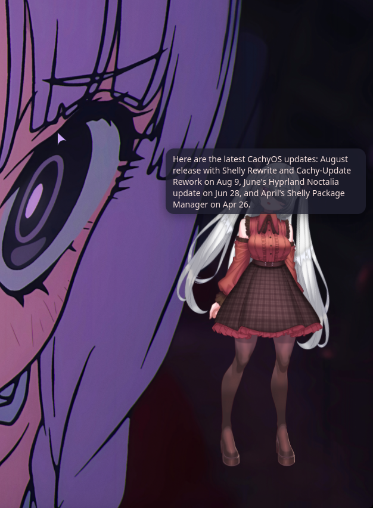
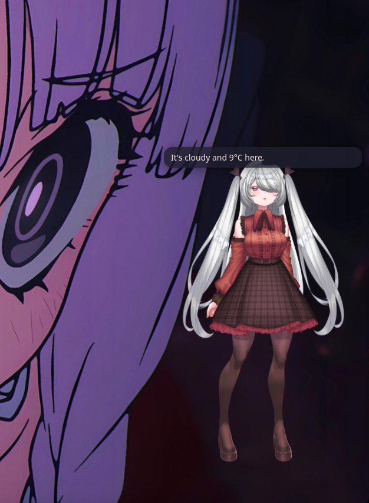
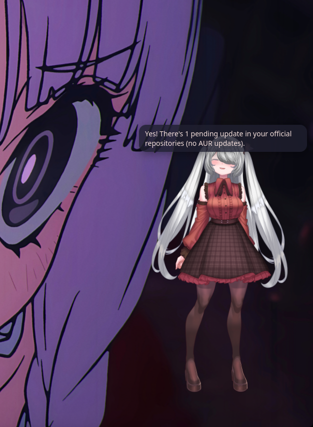

# Mio

Mio is the voice assistant I built for my own Linux desktop. I press a key (or just say "Hey Mio"), talk,
and a small Live2D character pops up in the corner of my screen, answers out loud and actually does the
thing: opens apps, moves windows, controls music, sets timers, reads the page I'm on, clicks the first
YouTube result, checks for system updates. When she's done, she disappears again.

I wanted something that felt like part of the desktop instead of a chat window, and that didn't burn
through API credits every time I asked for the volume to go down. So most of it runs locally, and the
cloud model only gets the requests the local stack really can't handle.

<table>
  <tr>
    <td></td>
    <td></td>
    <td></td>
  </tr>
  <tr>
    <td align="center"><sub>"What's new in CachyOS?"</sub></td>
    <td align="center"><sub>"How's the weather?"</sub></td>
    <td align="center"><sub>"Do I have updates?"</sub></td>
  </tr>
</table>

She sits on top of everything in the corner of the screen, her face changes with what she says, her
mouth moves with her voice, and whatever she answers also shows up in a bubble. Requests like these are handled by local tools and the local
model, so they cost nothing. The model she's wearing is
[yuri by creape](https://booth.pm/ja/items/4798949), a free Live2D model. It isn't included in this repo,
but any Cubism 3/4/5 model works.

> Built for my setup: CachyOS (Arch), the niri Wayland compositor, the Noctalia shell, and an NVIDIA GPU.
> It'll take some adapting to run anywhere else, but the architecture should still be interesting to read.

## How a request flows

```
mic → Silero VAD → faster-whisper (GPU) → router → tools → Kokoro TTS → speakers + avatar lip-sync
                                             │
                     1. regex fast path ─────┤  "volume 40", "next song", "timer 10 minutes"  (no model at all)
                     2. local LLM (Ollama) ──┤  most things, with tool calling
                     3. Claude ──────────────┘  only when the local model has tried and failed
```

The parts I put the most work into:

- **The router.** A request first hits a set of regexes that handle the boring commands instantly. Anything
  else goes to a local model (qwen3.5 9B via Ollama) that only gets the handful of tools that match what
  was said, plus a "right now" line (focused window, browser tab, what's playing). If it fails, it gets a
  second, deeper try, then it researches the question itself or asks me a short follow-up. Claude is the
  last resort, with a daily cap.
- **Guards around a small model.** 8–9B models like to claim they did something without calling a tool,
  invent arguments ("your location", a made-up URL) or write questionable shell commands. Most of
  `brain/local.py` is code that catches those cases instead of trusting the prompt.
- **Learning from use.** Requests that worked are stored with their tool calls and replayed for similar
  requests (embedding search, ~0.2 s instead of a few seconds). Names from my browser history and tools are
  used to fix speech-to-text mishearings. While I'm away and the GPU is idle, she can fine-tune a LoRA on
  her own wins, and she only switches to it if it beats the base model on a held-out exam.
- **The avatar.** On Wayland a normal window can't stay on top of every workspace and be click-through,
  so the avatar is a GTK4 layer-shell overlay with WebKit rendering a Live2D model (pixi.js). Clicks go
  through everywhere except on her.
- **Browser extension.** A small Brave/Chromium extension plus a native-messaging bridge, so she can read
  pages, control videos, switch tabs and click results. Banking, payment and login pages are off-limits,
  and she never types into password fields.
- **Safety.** Every tool call goes through one permission gate and an audit log. Shell commands are
  allow-listed, anything destructive needs a spoken "yes", files go to the trash instead of `rm`, and whole
  folders like `~/Downloads` can't be deleted by voice (I learned that one the hard way).

## Stack

Python 3.12 (uv), faster-whisper, Silero VAD, Kokoro TTS, Ollama, Claude via the Claude Code CLI,
GTK4 + gtk4-layer-shell + WebKitGTK, pixi.js + pixi-live2d-display, a Manifest V3 browser extension,
systemd user services.

## Repo layout

| Path | What's in it |
|---|---|
| `assistant/` | The daemon: speech in/out, router, tools, learning, timers, game mode, clips |
| `assistant/brain/` | Fast path, local model and Claude brains |
| `avatar/` | The layer-shell window and the Live2D web view |
| `browser/extension/` | The browser extension and its popup |
| `scripts/` | Install scripts and `school.py`, a test harness that grades her on ~300 example requests |
| `tests/` | The "school" curricula |
| `config/config.toml` | Default config with comments for every option |
| `docs/README.md` | The full guide: install, configuration, every feature, troubleshooting |

## Running it

The short version is in [docs/README.md](docs/README.md): install the system packages listed there, then
clone this repo to `~/mio-assistant` and run `scripts/install.sh`. It sets up the venv, downloads the
speech models and the sample avatar, pulls the Ollama model and enables the two user services. Press Mod+A
and talk.

The Live2D models and the Cubism runtime aren't included, because they come with their own licenses.
`scripts/fetch_assets.sh` downloads the free samples, or you can drop in any Cubism 3/4/5 model.

No API keys are needed. Claude runs through a logged-in `claude` CLI, and everything else is local or uses
public keyless endpoints. If you'd rather use an API key, put it in `~/.config/assistant/env`, never in the
config (see `config/env.example`).
